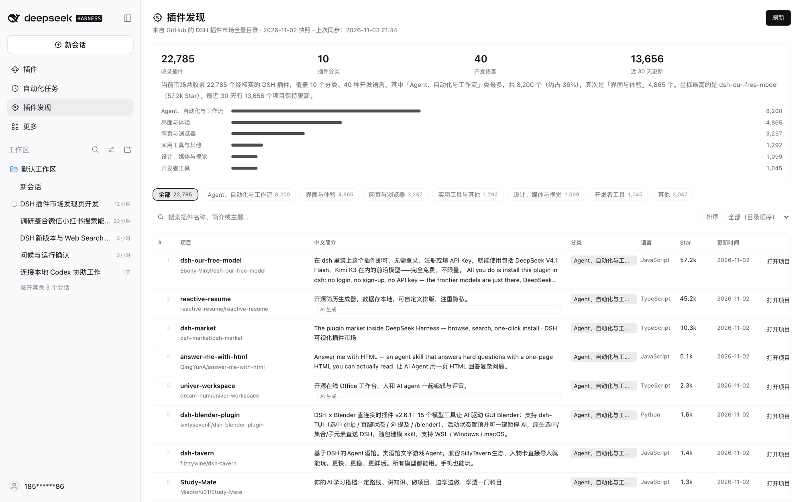

# Plugin Discovery · DSH Plugin Discovery

[中文](README.md) | [**English**](README.en.md)

## Latest v1.2.0 (2026-11-06)

[Release notes](https://github.com/HiddenPuppy/dsh-plugin-discovery/releases/tag/v1.2.0) · What changed:

- **One-click install**: every row has an **Install** button that adds the plugin to the current DSH profile and then reports whether it worked and roughly where to find it
- **Installed marker**: plugins already in this profile show **✓ Installed** instead of the install button
- **Refresh 404 fixed**: catalog volume files are discovered at runtime, so renames and splits upstream no longer break refreshing
- The catalog currently lists **24,075** plugins, **639** of which support one-click install from npm

> A **Plugin Discovery** page under the DSH sidebar (below *Automations*): the complete GitHub-hosted DSH plugin marketplace, with 24k+ plugins, a one-sentence Chinese description for every project, GitHub README links and one-click installation.



## What it does

- **The full catalog**: syncs the community-maintained DSH plugin catalog on GitHub (every repository verified under the `dsh-plugin` topic — **24,075** right now) and groups it into the same 10 categories the upstream catalog uses.
- **A Chinese description for every project**: one sentence explaining what each plugin does. Repository-provided Chinese comes first, then an AI-generated Chinese summary bundled with this repo; newly listed projects get an automatic Chinese category summary until translated, with the original English description kept below.
- **Head-category filters**: only the 6 head categories become filter chips; the long tail folds into *Other*.
- **Three sort modes**: catalog order (default), most stars, recently updated — plus keyword search and 50 / 100 / 200 rows per page.
- **Refreshes on every open**: paints instantly from a local cache, syncs the latest catalog in the background, then swaps in the new data. The **Refresh** button in the corner forces a sync.
- **Ecosystem overview**: plugin count, categories, languages, projects updated in the last 30 days, an auto-generated Chinese summary, and a category distribution bar.
- **Open the project**: clicking a row (or **Open project ↗**) opens the plugin's GitHub page so you can read its README before installing.
- **One-click install**: every row has an **Install** button. It asks the DSH plugin manager to add that plugin to this profile, preferring the catalog's npm install target (639 plugins have one) and falling back to the GitHub repository. While it runs the page shows progress; when it finishes an inline status card says **whether it worked**, the installed version and **roughly where to find it** (sidebar / settings / agent tools / slash commands / notifications …), plus how to fix common failures (build scripts blocked, network unreachable, already installed, not a bundle).
- **Installed markers**: plugins already present in this profile show **✓ Installed** instead of the install button.

## Install

Requires **DSH V0.2.1-rc.5 or newer**.

1. Open **Plugins** in the DSH sidebar → **Add plugin** → **Install a third-party plugin**.
2. Paste this repository's Git URL:

   ```text
   https://github.com/HiddenPuppy/dsh-plugin-discovery
   ```

3. After installation, **Plugin Discovery** appears under *Automations* in the sidebar. Refresh the window if it does not show up immediately.

You can also let an agent install it (`plugin_manager` → `install_bundle` with the Git URL or a local absolute path), or `git clone` this repo and pass the local path to the install dialog.

## Data source

- Catalog: [bruc3van/awesome-dsh-plugin](https://github.com/bruc3van/awesome-dsh-plugin), the community-maintained full catalog of the GitHub `dsh-plugin` topic.
- Downloads the repository archive from GitHub's codeload (one ~10 MB request) and reads every `catalog/*.md` volume it contains. The catalog renames and splits volumes as it grows, so file names are **discovered at runtime** instead of being hardcoded.
- If the archive is unreachable, falls back to reading `CATALOG.md` and downloading the volume files it lists through a mirror chain: `raw.githubusercontent.com` → jsDelivr → GitHub acceleration mirrors (`gh-proxy.com`, `ghfast.top`, `ghproxy.net`). The page footer shows the upstream snapshot date and the last sync time.
- The upstream catalog refreshes once a day; this plugin attempts a sync every time you open the page.

## How the Chinese descriptions are produced

| Source | Count | Notes |
| --- | ---: | --- |
| Repository-provided Chinese | ~11.9k | The repository's own Chinese description |
| AI-generated Chinese | ~11.8k | Cached in [`zh-descriptions.json`](zh-descriptions.json); edit it and refresh the page to override |
| Automatic category summary | new entries | Until a Chinese description exists, a sentence is generated from category and language |

Descriptions combine repository text with model-generated summaries and are for reference only; the repository itself is authoritative.

## Project layout

```text
.
├── index.js              # Host half: fetch volumes, parse, Chinese fallback, disk cache, API routes
├── client.js             # Browser half: sidebar entry + main panel page
├── cordis.patch.yml      # Bundle patch: inserts the plugin-discovery row
├── locale/{zh,en}.json   # Title and description shown by the plugin manager
├── icon.svg              # Plugin icon (puzzle piece + magnifier)
├── zh-descriptions.json  # AI Chinese description cache (owner/repo → Chinese)
├── docs/screenshot.png   # Usage screenshot
└── tools/                # Offline normalization check, route e2e test, live sync, cache warm-up
```

The Host half registers two routes on DSH's authenticated API channel:

- `GET /api/plugin-discovery/feed` — the normalized catalog; `?refresh=1` starts a background refresh, `?wait=1` waits for the in-flight refresh before responding
- `GET /api/plugin-discovery/meta` — sync status (last sync time, refreshing, error message)
- `POST /api/plugin-discovery/install` — starts installing one catalog repository through `ctx.pluginManager`; returns a job id
- `GET /api/plugin-discovery/install/status?id=…` — job state and the final install result (friendly error + placement hints)
- `GET /api/plugin-discovery/installed` — bundles already installed in this profile (for the ✓ marker)

The browser never talks to GitHub directly: download, parsing, classification and caching all happen in the Host; the browser only renders the result.

## Development & verification

```bash
node tools/live-test.mjs                     # one real upstream sync, prints the stats
node tools/route-test.mjs /path/to/catalog   # route, cache and failure-fallback test with local volumes
node tools/warm-cache.mjs                    # pre-warm the current profile's disk cache
```

## License

MIT

## Changelog

- **1.2.0** — One-click install: each row gains an **Install** button that installs the plugin into the current DSH profile through the plugin manager (npm install target first), then reports success/failure, the installed version and where to find it. Already-installed plugins are marked ✓. Failures are classified into actionable messages (build scripts blocked, network unreachable, already installed, not a DSH bundle). Catalog now lists 24,075 plugins.
- **1.1.0** — Fixed the Refresh button failing with `upstream 404` whenever the upstream catalog renamed or split its volume files. Volume names are now discovered at runtime (repository archive first, then `CATALOG.md` + per-file mirror chain), so the page keeps refreshing as the catalog grows. Catalog now lists 23,659 plugins.
- **1.0.0** — First release.
