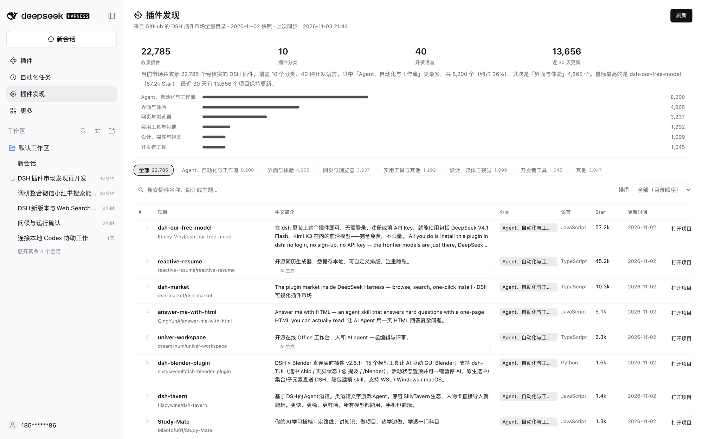

# Plugin Discovery · DSH Plugin Discovery

[**English**](README.md) | [中文](README.zh.md)

> A **Plugin Discovery** page under the DSH sidebar (below *Automations*): the complete GitHub-hosted DSH plugin marketplace, with 22k+ plugins and a one-sentence Chinese description for every project.



## What it does

- **The full catalog**: syncs the community-maintained DSH plugin catalog on GitHub (every repository verified under the `dsh-plugin` topic — **22,785** right now) and groups it into the same 10 categories the upstream catalog uses.
- **A Chinese description for every project**: one sentence explaining what each plugin does. Repository-provided Chinese comes first, then an AI-generated Chinese summary bundled with this repo; newly listed projects get an automatic Chinese category summary until translated, with the original English description kept below.
- **Head-category filters**: only the 6 head categories become filter chips; the long tail folds into *Other*.
- **Three sort modes**: catalog order (default), most stars, recently updated — plus keyword search and 50 / 100 / 200 rows per page.
- **Refreshes on every open**: paints instantly from a local cache, syncs the latest catalog in the background, then swaps in the new data. The **Refresh** button in the corner forces a sync.
- **Ecosystem overview**: plugin count, categories, languages, projects updated in the last 30 days, an auto-generated Chinese summary, and a category distribution bar.
- Click any row or **Open project ↗** to jump to the plugin's GitHub repository.

## Install

Requires **DSH V0.2.1-rc.5 or newer**.

1. Open **Plugins** in the DSH sidebar → **Add plugin** → **Install a third-party plugin**.
2. Paste this repository's Git URL:

   ```text
   https://github.com/HiddenPuppy/dsh-plugin-discovery
   ```

3. After installation, **Plugin Discovery** appears under *Automations* in the sidebar. Refresh the window if it does not show up immediately.

You can also let an agent install it (`plugin_manager` → `install_bundle` with the Git URL or a local absolute path), or `git clone` this repo and pass the local path to the install dialog.

## Data source

- Catalog: [bruc3van/awesome-dsh-plugin](https://github.com/bruc3van/awesome-dsh-plugin), the community-maintained full catalog of the GitHub `dsh-plugin` topic.
- Reads its 13 per-category volumes (`catalog/*.md`, ~6 MB total) instead of the 22 MB `repositories.json`: lighter, friendlier to networks where GitHub raw is slow, and categories come straight from the volumes.
- Tries `raw.githubusercontent.com` first (freshest data) and falls back to the jsDelivr mirror per file when a request times out or fails. The page footer shows the upstream snapshot date and the last sync time.
- The upstream catalog refreshes once a day; this plugin attempts a sync every time you open the page.

## How the Chinese descriptions are produced

| Source | Count | Notes |
| --- | ---: | --- |
| Repository-provided Chinese | ~11.4k | The repository's own Chinese description |
| AI-generated Chinese | ~11.4k | Cached in [`zh-descriptions.json`](zh-descriptions.json); edit it and refresh the page to override |
| Automatic category summary | new entries | Until a Chinese description exists, a sentence is generated from category and language |

Descriptions combine repository text with model-generated summaries and are for reference only; the repository itself is authoritative.

## Project layout

```text
.
├── index.js              # Host half: fetch volumes, parse, Chinese fallback, disk cache, API routes
├── client.js             # Browser half: sidebar entry + main panel page
├── cordis.patch.yml      # Bundle patch: inserts the plugin-discovery row
├── locale/{zh,en}.json   # Title and description shown by the plugin manager
├── icon.svg              # Plugin icon (puzzle piece + magnifier)
├── zh-descriptions.json  # AI Chinese description cache (owner/repo → Chinese)
├── docs/screenshot.png   # Usage screenshot
└── tools/                # Offline normalization check, route e2e test, live sync, cache warm-up
```

The Host half registers two routes on DSH's authenticated API channel:

- `GET /api/plugin-discovery/feed` — the normalized catalog; `?refresh=1` starts a background refresh, `?wait=1` waits for the in-flight refresh before responding
- `GET /api/plugin-discovery/meta` — sync status (last sync time, refreshing, error message)

The browser never talks to GitHub directly: download, parsing, classification and caching all happen in the Host; the browser only renders the result.

## Development & verification

```bash
node tools/live-test.mjs                     # one real upstream sync, prints the stats
node tools/route-test.mjs /path/to/catalog   # route, cache and failure-fallback test with local volumes
node tools/warm-cache.mjs                    # pre-warm the current profile's disk cache
```

## License

MIT
