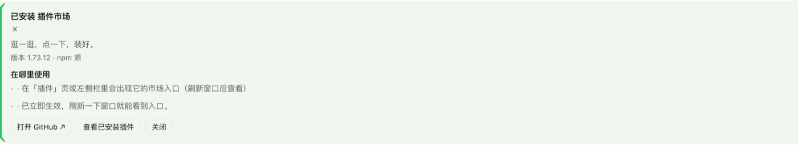
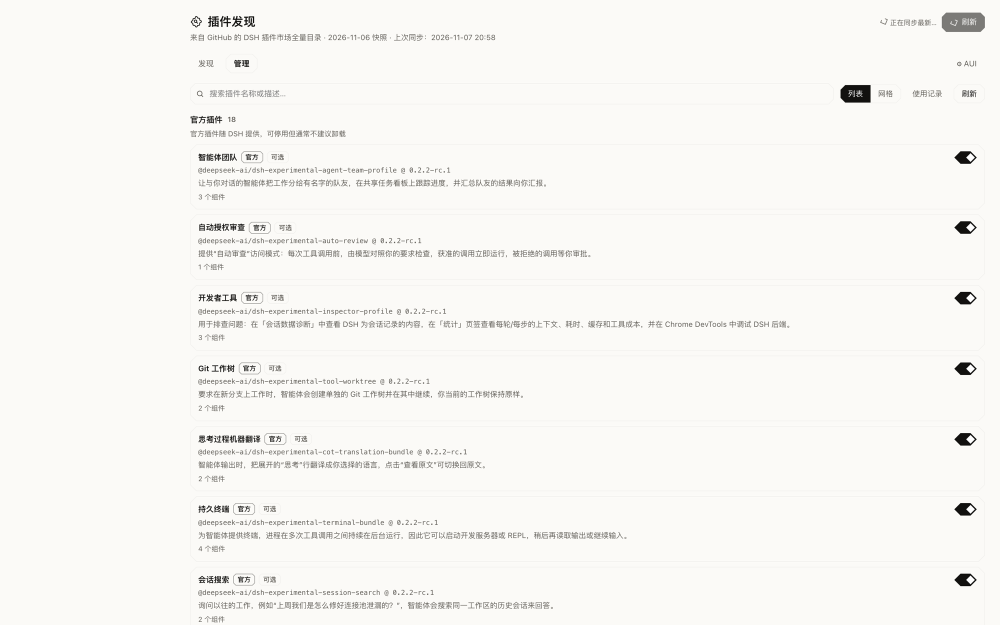
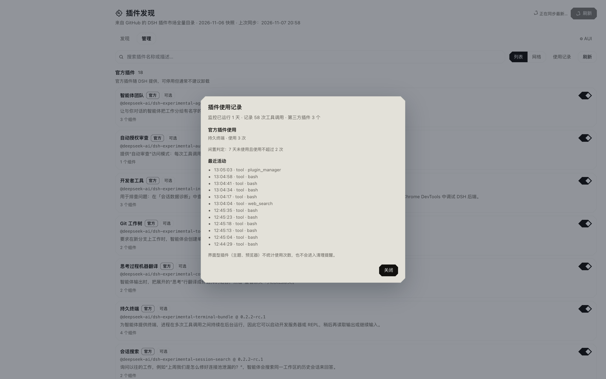
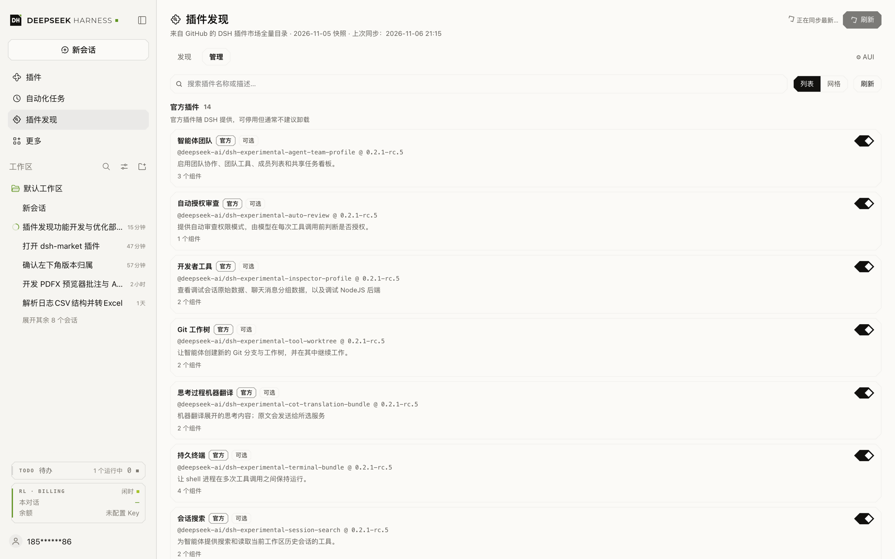

# 插件发现 · DSH Plugin Discovery

[**中文**](README.md) | [English](README.en.md)

## 最新版本 v1.9.0（2026-11-07）

[Release 说明](https://github.com/HiddenPuppy/dsh-plugin-discovery/releases/tag/v1.9.0) · 这次重做了 AUI 的思考方式：

- **AUI 变成后台轻量思考线程**：不再是「用户说一句 → 同步拿这句话做文本检索」，而是后台先读懂你要解决的具体问题，再生成检索词去插件市场找，最后判断「有没有插件能刚好解决」
- **宁缺毋滥**：只是相关的、需要你自己再补很多步骤的，都不推荐；没有合适的就保持安静
- **能耗可控**：后台思考有每小时次数和最小间隔限制；推荐本身有冷却 / 每小时 / 每会话上限，都可以在「⚙ AUI」里调
- 黄金题 36 条：**23/26 需求推对、10 条日常对话 0 误报（91.7%）**；从发消息到卡片约 **4～5 秒**
- 仍然会漏掉「没有单一插件能完整覆盖」的需求（例如一体化侧边栏、B 站日报、销售 CRM）：这类会保持安静，而不是硬推一个近似插件

> 在 DSH 左侧栏「自动化任务」下方加一个「插件发现」页面：把 GitHub 上社区维护的 **DSH 插件市场全量目录**接进 Harness，2.4 万+ 插件一览无余，每个项目都配一句中文简介，还能直接点「安装」装进当前 DSH。


安装完成后的状态卡片（版本、安装源、使用位置）：



## GUI 和 AUI：两种逛插件市场的方式

- **GUI（图形界面）**：你自己打开插件发现页，翻分类、搜关键词、看简介，觉得合适就点安装。就像自己去超市货架前挑东西。
- **AUI（给 Agent 用的界面）**：你什么都不用做，正常和 DSH 聊需求。DSH 在后台悄悄判断「这句话背后有没有一个插件真的能帮上忙」，值得才在右下角递给你一张小卡片。就像有个懂行的店员，听到你要什么才把东西递过来。

不管哪种方式，**安装永远要你点确认**；AUI 不想被打扰，也可以随时在「⚙ AUI」里关掉。

## 它做什么

- **全量目录**：实时同步 GitHub 社区维护的 DSH 插件全量目录（`dsh-plugin` topic 核实收录，当前 **24,505** 个），按与上游相同的规则归入 10 个分类。
- **中文简介**：每个项目一句中文说明它是干什么的。优先使用项目自带中文简介，其次是随仓库打包的 AI 中文简介；新收录的项目会先显示按分类与语言生成的中文归类摘要，英文原简介保留在下方。
- **头部类目筛选**：只把头部 6 个分类做成筛选胶囊，长尾分类统一折叠进「其他」。
- **三种排序**：全部（目录顺序）、最高 Star、最新更新；支持关键词搜索、每页 50 / 100 / 200 条分页。
- **每次打开自动刷新**：先用本地缓存秒开，同时后台向 GitHub 同步一次，完成后自动替换为最新数据；右上角「刷新」可手动同步。
- **生态概况**：收录总数、分类数、语言数、近 30 天更新数，一段自动生成的中文总结，以及头部分类的数量分布条。
- **查看项目**：点击任意一行（或「打开项目 ↗」）会打开对应 GitHub 仓库，先看 README 再决定要不要装。
- **一键安装**：每行都有「安装」按钮，点击后由 DSH 插件管理器把该插件装进当前 profile——优先使用目录里的 npm 安装源（639 个插件有 npm 源），没有时回退到 GitHub 仓库。安装期间显示进度；结束后页面内会出现状态卡片，说明**装好了还是没有装好**、安装的版本、以及**大致在哪里使用**（侧边栏 / 设置 / Agent 工具 / 斜杠命令 / 通知……），并给出常见失败的处理办法（构建脚本被拦、网络不可达、已安装、不是插件包）。
- **已安装标记**：当前 profile 里已有的插件会显示「✓ 已安装」，不再重复安装。
- **安装失败可现场处理**：构建脚本被拦截时状态卡提供「允许并重试」（自动写入当前 profile 的 `pnpm-workspace.yaml` `allowBuilds`）；GitHub 源码包不可用但存在同仓库 npm 包时提供「改用 npm 源安装」，无需构建脚本。
- **AUI：聊天时帮你发现插件**：先快速挑候选，再让模型悄悄判断值不值得推荐；值得才在右下角轻轻提示，确认前不会安装。
- **插件管理**：顶部「管理」页集成官方插件与已安装第三方插件的启停 / 卸载，支持列表与网格视图。

## AUI：聊天时帮你发现插件


AUI 不是在每条消息后面同步做一次文本匹配，而是在后台起一个轻量的「插件顾问」思考线程：

1. **先读懂**：结合最近几条对话，理解你真正想解决的具体问题（目标 + 需要的能力），并生成用于搜索插件市场的关键词——会用插件圈的术语，也会覆盖你口语里的不同说法
2. **再检索**：用这些关键词在 2.4 万条目录里召回候选插件
3. **再判断**：让模型逐条对照「刚好能解决」这个标准，判断哪个插件能直接完成你的核心任务；判断不了、只是相关、或者需要你再补很多步骤，就保持安静
4. **必要时重试**：第一轮没有合适的，会带着「还缺什么能力」再检索一次

只有「刚好能解决 + 贴合度达标 + 频率允许」时，才在右下角弹出卡片；**安装仍然必须你点**。

- **速度**：从发出消息到看到卡片通常 4～5 秒（两段思考；闲聊/常识类会跳过第二段，更快）
- **能耗可控**：后台思考默认每小时最多 12 次、两次之间至少 20 秒；模型不可用就静默
- **安静优先**：推荐冷却 4 分钟、每小时最多 4 次、每会话最多 2 次
- **可配置**：「插件发现 → ⚙ AUI」里可以调最低贴合度、思考频率上限、推荐频率上限，也可以「试一下」预览

### 效果怎么样？

仓库里带了一套 36 条的「黄金题」——26 条真实需求 + 10 条应该保持安静的日常对话（包括之前误推过的小红书视频用例）。当前结果：

| 指标 | 结果 |
| --- | --- |
| 需求推对 | **23 / 26** |
| 日常对话误推 | **0 / 10** |
| 准确率 / 精确率 | **91.7% / 100%** |
| 平均思考耗时 | ~4.4 秒 |

剩下 3 条是「没有单一插件能完整覆盖」的需求（一体化侧边栏、B 站日报、销售 CRM），AUI 选择保持安静而不是推近似插件——这是「刚好能解决」标准下的取舍。完整报告见 `tools/aui-eval-report.md`，可以用 `tools/aui-eval.py` 复跑。

## 插件使用情况（本地日志）



使用情况不再占据一大块版面，而是分三层：

1. **入口**：「管理」页工具栏里的「使用记录」按钮
2. **行内**：第三方工具型插件在自己的卡片里带一行小字（使用次数 / 最近使用时间）；界面型插件不显示
3. **提醒**：真的存在「装了但很少用」的插件时，安装列表上方才会出现一条提醒，展开可以逐个卸载

点「使用记录」看到的是明细：



会记录：

- **记录什么**：每次工具调用（工具名、时间、属于哪个插件）、安装 / 移除动作、AUI 推荐过哪些插件
- **怎么知道属于谁**：在本机扫描已安装插件包里的工具声明，把工具名对回插件；官方插件只读扫描本机安装目录，用来做参考
- **清理提醒**：第三方插件「首次记录满 7 天 + 最近 7 天没用 + 总使用不超过 2 次」时，会进入「装了但很少用」提醒，可以直接卸载；卸载后 AUI 仍会在下次相关需求时重新推荐它
- **只在本机**：日志写在 `~/.dsh/cache/plugin-discovery/usage.jsonl`，不会上传
- **界面型插件**：不统计使用次数，也不会进入清理提醒（弹窗底部一行说明，不再单独占版面）

## 插件管理



顶部导航的「管理」页把 DSH 自带的插件管理能力集成进来：

- **官方插件**：随 DSH 提供的组合包（含实验性可选插件），可直接开关，停用的会标记
- **已安装的第三方插件**：装进当前 profile 的插件，可开关或卸载（两步确认）
- **列表 / 网格**：默认列表，可一键切换网格；支持搜索过滤
- 开关、卸载都直接走 DSH 插件管理器，需要重启时会明确提示

## 安装

要求 **DSH V0.2.1-rc.5 及以上**。

1. 打开 DSH 左侧「插件」→「添加插件」→「安装第三方插件」。
2. 在输入框填入本仓库的 Git 地址：

   ```text
   https://github.com/HiddenPuppy/dsh-plugin-discovery
   ```

3. 安装完成后，左侧栏「自动化任务」下方会出现「插件发现」。若没有立即出现，刷新一下窗口即可。

也可以让 Agent 代为安装（`plugin_manager` 的 `install_bundle` 指向 Git 地址或本地绝对路径），或先 `git clone` 本仓库，再把本地绝对路径填进安装对话框。

## 安装失败怎么办

状态卡会尽量给出可以直接点的操作：

| 情况 | 状态卡提示 | 处理方式 |
| --- | --- | --- |
| 依赖的安装脚本被 pnpm 拦截 | 「允许并重试」 | 写入当前 profile 的 `allowBuilds` 后自动重试；允许会执行插件自带的脚本，请确认来源可信 |
| GitHub 源码包需要 prepare / 构建失败 | 「允许并重试」；仍失败时给 npm 方案 | 若同一仓库发布了 npm 包，改用「改用 npm 源安装」，无需构建脚本 |
| 检测到同仓库的官方 npm 包 | 「改用 npm 源安装（包名@版本）」 | 直接用 npm 包安装，例如 `dsh-market` → `dshmarket@1.73.12` |
| GitHub 无法访问（网络超时） | 提示网络不可达；有 npm 包时提供 npm 方案 | 换成 npm 源，或稍后重试 |
| 已经安装过 / 不是 DSH 插件包 | 明确说明原因 | 无需重复安装，或去仓库确认是否为插件 |

> 说明：DSH 自带「插件」页只对 npm 依赖的构建脚本提供「允许这些脚本并重试」，对 **Git 源码包的 prepare 脚本**没有对应按钮（只能手动改 `pnpm-workspace.yaml`）。本插件把这个流程做进了状态卡，所以不需要自己去改配置文件。

## 数据来源

- 目录：[bruc3van/awesome-dsh-plugin](https://github.com/bruc3van/awesome-dsh-plugin)，GitHub `dsh-plugin` topic 的社区维护全量目录。
- 直接下载仓库归档包（GitHub codeload，一次约 10 MB 请求），读取其中全部 `catalog/*.md` 分类分册；上游会随目录增长拆分、改名分册文件，所以文件名是**运行时发现**的，不会因为上游改名而失效。
- 归档包不可达时，退化为读取 `CATALOG.md` 索引，再按索引逐个下载分册，依次尝试 `raw.githubusercontent.com` → jsDelivr → GitHub 加速镜像（gh-proxy.com / ghfast.top / ghproxy.net）；页面底部会标注快照日期与上次同步时间。
- 目录每天由上游刷新一次，本插件每次打开页面都会尝试同步。

## 中文简介是怎么来的

| 来源 | 数量 | 说明 |
| --- | ---: | --- |
| 项目自带中文 | 约 1.19 万 | 仓库自己的中文简介 |
| AI 生成中文 | 约 1.18 万 | 缓存在 [`zh-descriptions.json`](zh-descriptions.json)，可自行修订，刷新页面后生效 |
| 自动归类摘要 | 新增项目 | 收录后暂无中文时，按分类与开发语言生成一句中文概括 |

简介由项目作者原文与模型生成结果组成，仅供参考；以项目仓库为准。

## 目录结构

```text
.
├── index.js              # Host 半侧：拉取分册、解析、中文兜底、磁盘缓存、API 路由
├── client.js             # 浏览器半侧：侧边栏入口 + main 面板页面
├── cordis.patch.yml      # bundle 补丁：插入 plugin-discovery 一行
├── locale/{zh,en}.json   # 插件管理器中展示的标题与描述
├── icon.svg              # 插件图标（拼图 + 放大镜）
├── zh-descriptions.json  # AI 中文简介缓存（owner/repo → 中文）
├── docs/screenshot.png   # 使用截图
└── tools/                # 离线归一化检查、路由端到端检查、真实上游联调、预热缓存
```

Host 半侧在 DSH 的鉴权 API 通道上注册两条路由：

- `GET /api/plugin-discovery/feed` —— 归一化后的插件目录；`?refresh=1` 触发后台刷新，`?wait=1` 等待进行中的刷新结束后返回
- `GET /api/plugin-discovery/meta` —— 同步状态（上次同步时间、是否刷新中、错误信息）
- `POST /api/plugin-discovery/install` —— 通过 `ctx.pluginManager` 开始安装一个目录里的插件，返回任务 id
- `POST /api/plugin-discovery/install/approve` —— 对上一次失败的安装执行授权重试（写入 allowBuilds / 批准构建脚本 / 改用 npm 源）
- `GET /api/plugin-discovery/bundles`、`POST …/bundles/enable`、`POST …/bundles/remove` —— 管理页使用的官方 / 已安装插件列表、启停与卸载
- `GET/POST /api/plugin-discovery/aui`、`GET …/aui/suggestion`、`POST …/aui/dismiss`、`POST …/aui/test`、`POST …/aui/eval` —— AUI 设置、待确认推荐、忽略、预览与黄金集评测
- `GET /api/plugin-discovery/usage` —— 本地插件使用统计（使用次数、最近使用、闲置提醒、最近活动）
- `GET /api/plugin-discovery/install/status?id=…` —— 任务状态与最终结果（友好错误信息 + 使用位置提示）
- `GET /api/plugin-discovery/installed` —— 当前 profile 已安装的 bundle（用于「✓ 已安装」标记）

浏览器半侧从不直连 GitHub：下载、解析、分类与缓存都在 Host 完成，浏览器只渲染结果。

## 开发与验证

```bash
node tools/live-test.mjs                     # 直连上游跑一次真实同步并打印统计
node tools/route-test.mjs /path/to/catalog   # 用本地分册快照测试路由、缓存与失败降级
node tools/warm-cache.mjs                    # 预热当前 profile 的磁盘缓存
```

## License

MIT

## 更新记录

- **1.9.0** — AUI 重做为后台轻量思考线程：先理解问题再生成检索词，检索后逐条判断「刚好能解决」，必要时再检索一轮；增加思考频率/间隔的能耗上限，最低置信度改为最低贴合度。黄金题 23/26 推对、0/10 误报（91.7%），平均 4.4 秒。
- **1.8.0** — 重新设计「插件使用情况」的呈现：从整块平铺改为「工具栏入口 + 卡片内一行小字 + 仅在确有闲置时出现的提醒」，界面型插件不再占版面；数据结构与统计逻辑不变。
- **1.7.0** — 新增本地插件使用监控：记录工具调用 / 安装 / 移除 / AUI 推荐，在「管理」页显示每个第三方插件的使用次数与最近使用时间；「用了很少且很久没用」的插件会进入清理提醒，可一键卸载，下次需要时 AUI 会再找回。移除名不副实的「看看同类插件」。
- **1.6.0** — AUI 更快更准：「看看同类插件」改为按分类浏览（不再用插件名精确搜索）、推荐卡片轮询从 4 秒降到 1 秒、模型判断更稳；黄金集 36 条，25/26 推对、0/10 误报（97.2%）；README 增加 GUI / AUI 通俗说明与同类插件截图。
- **1.5.0** — AUI 从纯文本匹配升级为「本地召回 + 模型静默判断」：模型判断不值得或置信度不足时保持安静，频率控制默认冷却 240 秒 / 每小时 4 次 / 每会话 2 次；新增 36 条黄金集与评测脚本，当前准确率 94.4%、负例误报 0/10。
- **1.4.0** — 新增 AUI：对话中本地匹配并右下角推荐插件（用户确认后才安装，可配置开关 / 灵敏度 / 冷却，可在设置里「试一下」）；新增「插件管理」页，集成官方插件与已安装第三方插件的启停 / 卸载与列表 / 网格视图。
- **1.3.0** — 安装失败可直接处理：状态卡提供「允许并重试」（自动写 `allowBuilds`）与「改用 npm 源安装」（同一仓库有 npm 包时），并持久化「✓ 已安装」标记。修复 DSH「插件」页找不到构建授权入口的问题（Git 源码包 prepare 脚本没有对应 UI）。
- **1.2.0** — 一键安装：每行新增「安装」按钮，点击后通过插件管理器把插件装进当前 DSH profile（优先 npm 安装源），并给出安装成功/失败、版本与大致使用位置；已安装插件显示「✓ 已安装」。失败原因会归类成可操作的中文提示（构建脚本被拦 / 网络不可达 / 已安装 / 不是 DSH 插件包）。当前收录 24,075 个插件。
- **1.1.0** — 修复点击「刷新」报 `upstream 404` 的问题：上游目录会拆分/改名前缀分册文件，旧版本硬编码了分册文件名。现在改为运行时发现分册（优先下载仓库归档包，失败时读 `CATALOG.md` 索引再按镜像链逐一下载），目录增长后也不会失效。
- **1.0.0** — 首次发布。
