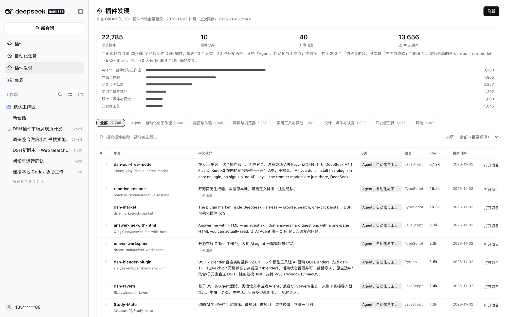

# 插件发现 · DSH Plugin Discovery

[English](README.md) | [**中文**](README.zh.md)

> 在 DSH 左侧栏「自动化任务」下方加一个「插件发现」页面：把 GitHub 上社区维护的 **DSH 插件市场全量目录**接进 Harness，2.2 万+ 插件一览无余，每个项目都配一句中文简介。



## 它做什么

- **全量目录**：实时同步 GitHub 社区维护的 DSH 插件全量目录（`dsh-plugin` topic 核实收录，当前 **22,785** 个），按与上游相同的规则归入 10 个分类。
- **中文简介**：每个项目一句中文说明它是干什么的。优先使用项目自带中文简介，其次是随仓库打包的 AI 中文简介；新收录的项目会先显示按分类与语言生成的中文归类摘要，英文原简介保留在下方。
- **头部类目筛选**：只把头部 6 个分类做成筛选胶囊，长尾分类统一折叠进「其他」。
- **三种排序**：全部（目录顺序）、最高 Star、最新更新；支持关键词搜索、每页 50 / 100 / 200 条分页。
- **每次打开自动刷新**：先用本地缓存秒开，同时后台向 GitHub 同步一次，完成后自动替换为最新数据；右上角「刷新」可手动同步。
- **生态概况**：收录总数、分类数、语言数、近 30 天更新数，一段自动生成的中文总结，以及头部分类的数量分布条。
- 点击任意一行或「打开项目 ↗」直接跳转对应 GitHub 仓库。

## 安装

要求 **DSH V0.2.1-rc.5 及以上**。

1. 打开 DSH 左侧「插件」→「添加插件」→「安装第三方插件」。
2. 在输入框填入本仓库的 Git 地址：

   ```text
   https://github.com/HiddenPuppy/dsh-plugin-discovery
   ```

3. 安装完成后，左侧栏「自动化任务」下方会出现「插件发现」。若没有立即出现，刷新一下窗口即可。

也可以让 Agent 代为安装（`plugin_manager` 的 `install_bundle` 指向 Git 地址或本地绝对路径），或先 `git clone` 本仓库，再把本地绝对路径填进安装对话框。

## 数据来源

- 目录：[bruc3van/awesome-dsh-plugin](https://github.com/bruc3van/awesome-dsh-plugin)，GitHub `dsh-plugin` topic 的社区维护全量目录。
- 读取其 13 个分类分册（`catalog/*.md`，合计约 6 MB），而不是 22 MB 的 `repositories.json`：体积更小、国内网络更稳，分类也直接来自上游分册。
- 优先直连 `raw.githubusercontent.com`（数据最新），单个文件超时或失败时自动切换到 jsDelivr 镜像；页面底部会标注快照日期与上次同步时间。
- 目录每天由上游刷新一次，本插件每次打开页面都会尝试同步。

## 中文简介是怎么来的

| 来源 | 数量 | 说明 |
| --- | ---: | --- |
| 项目自带中文 | 约 1.14 万 | 仓库自己的中文简介 |
| AI 生成中文 | 约 1.14 万 | 缓存在 [`zh-descriptions.json`](zh-descriptions.json)，可自行修订，刷新页面后生效 |
| 自动归类摘要 | 新增项目 | 收录后暂无中文时，按分类与开发语言生成一句中文概括 |

简介由项目作者原文与模型生成结果组成，仅供参考；以项目仓库为准。

## 目录结构

```text
.
├── index.js              # Host 半侧：拉取分册、解析、中文兜底、磁盘缓存、API 路由
├── client.js             # 浏览器半侧：侧边栏入口 + main 面板页面
├── cordis.patch.yml      # bundle 补丁：插入 plugin-discovery 一行
├── locale/{zh,en}.json   # 插件管理器中展示的标题与描述
├── icon.svg              # 插件图标（拼图 + 放大镜）
├── zh-descriptions.json  # AI 中文简介缓存（owner/repo → 中文）
├── docs/screenshot.png   # 使用截图
└── tools/                # 离线归一化检查、路由端到端检查、真实上游联调、预热缓存
```

Host 半侧在 DSH 的鉴权 API 通道上注册两条路由：

- `GET /api/plugin-discovery/feed` —— 归一化后的插件目录；`?refresh=1` 触发后台刷新，`?wait=1` 等待进行中的刷新结束后返回
- `GET /api/plugin-discovery/meta` —— 同步状态（上次同步时间、是否刷新中、错误信息）

浏览器半侧从不直连 GitHub：下载、解析、分类与缓存都在 Host 完成，浏览器只渲染结果。

## 开发与验证

```bash
node tools/live-test.mjs                     # 直连上游跑一次真实同步并打印统计
node tools/route-test.mjs /path/to/catalog   # 用本地分册快照测试路由、缓存与失败降级
node tools/warm-cache.mjs                    # 预热当前 profile 的磁盘缓存
```

## License

MIT
